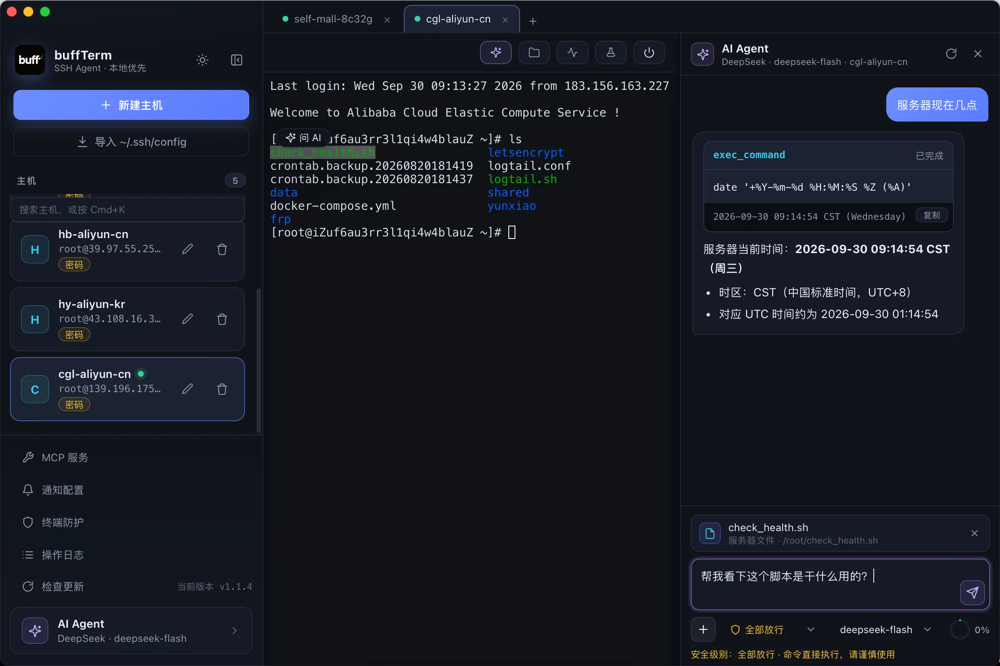
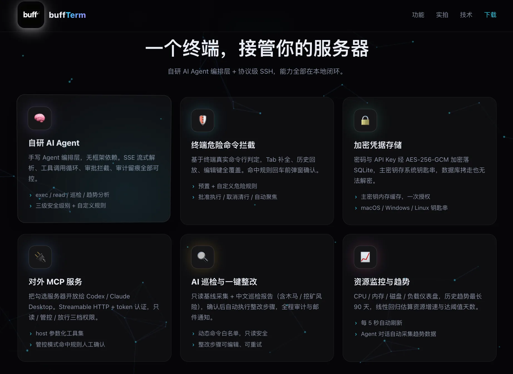
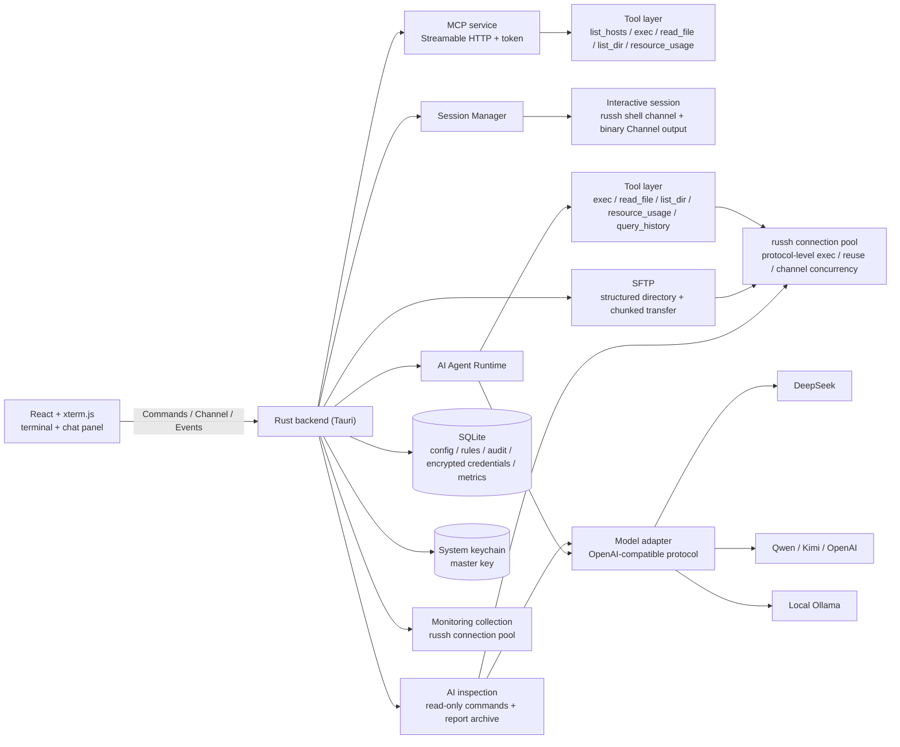

<p align="center">
  
</p>

# buffTerm

[简体中文](README.md) | **English**

> An AI-first SSH tool and MCP server
>
> Manage servers through natural language, locally — powered by a self-built agent orchestration layer.


[](https://shaguocgl.github.io/buff-term-site/)

buffTerm is an **AI-first SSH tool and MCP server**. It ships a **self-built AI agent orchestration layer** that works with any OpenAI-compatible model (DeepSeek, Qwen, Kimi, …), so you can inspect state, troubleshoot issues, install software and run operations in natural language.

It also exposes multiple hosts as an MCP server for other AI tools to call, with security levels under your control. Dangerous-command blocking, AI operation approval and auditing cover you end to end; **config, credentials and audit data stay on your machine**, while AI conversations and inspection content are sent to the model platform you configure.

> 🤖 **The agent orchestration layer is entirely self-built**: the core tool-calling loop (SSE streaming parse → tool execution → result backfill) is hand-written in this project and **does not depend on LangChain / OpenAI Agents SDK / Vercel AI SDK or similar frameworks** — approval interception, security policy and audit trails are all under our own control.

<p align="center">
  
</p>
<p align="center">
  <a href="https://shaguocgl.github.io/buff-term-site">
    
  </a>
</p>


## 📥 Download

Grab the latest installer from [GitHub Releases](https://github.com/shaguocgl/buff-term/releases):

- macOS: download the `.dmg` (Universal — Apple Silicon and Intel)
- Windows: download the `.exe`

> ⚠️ The macOS build is not Apple-notarized yet. Credentials are encrypted with AES-256-GCM and stored in a local SQLite database, while the master key lives in the system keychain. An unsigned development build may trigger a single keychain authorization prompt on first access — this is normal macOS behavior.

## ✨ Features

### AI Agent

- **Self-built agent orchestration layer**: SSE streaming parse, tool-calling loop, approval and auditing are all hand-written with no framework dependency
- **Protocol-level execution via russh**: AI tool calls share the unified SSH connection pool (connection reuse, channel concurrency, known_hosts verification)
- Multi-platform configuration: DeepSeek / OpenAI / Qwen / Kimi / Ollama, with multiple models per provider
- Tools: `exec_command`, `read_file`, `list_dir`, `resource_usage`, `query_history` (historical metric trends with minute / hour / day aggregation, chosen by the AI for the analysis at hand), `update_task_plan` (local task plan, no approval needed)
- Outgoing context is budgeted against the model window: older rounds are compressed into summaries while the task plan is always kept
- Independent conversation history per host, interruptible and clearable at any time

### MCP service

- **buffTerm as an MCP server**: Streamable HTTP + JSON-RPC + token authentication, exposing the servers you select to external AI tools such as Codex and Claude Desktop
- Three permission modes: read-only (only proven safe read-only commands; other commands and sensitive paths are rejected) / guarded (non-safe commands, sensitive paths or custom rules need confirmation) / allow all
- Generates the external AI's MCP configuration JSON on start, with token rotation and revocation

### SSH and SFTP

- **Protocol-level SSH**: the interactive terminal, AI, MCP, monitoring, inspection and SFTP all run on `russh` / `russh-sftp` — the system `ssh` / `sftp` commands are never invoked
- **Multiple authentication methods**: password, keyboard-interactive fallback, plain and encrypted private keys, Unix ssh-agent; RSA negotiates SHA-2 signatures automatically
- **Strict host key verification**: the first connection shows the SHA-256 fingerprint and waits for confirmation; a changed fingerprint is rejected outright and both the old and new fingerprints are shown
- **Connection reuse**: AI, MCP, monitoring, inspection and SFTP reuse one SSH connection per host with channel-level concurrency; idle connections are reclaimed automatically
- **Structured SFTP**: directory browsing, upload, download, rename, delete, mkdir, overwrite confirmation, progress and cancel; symlinks and file names with spaces are supported
- **Batch upload**: multi-select files, up to 3 concurrent transfers (each with its own progress and cancel, plus cancel-all); conflicting files are summarized into a single overwrite confirmation where you can choose "Overwrite all" or "Skip conflicting files" and upload only the rest
- **Built-in file editor**: open a file as a tab in the center area via the inline hover button (or by double-clicking the row) — CodeMirror 6 with extension-based highlighting, editing and Ctrl/Cmd+S saving; saves use "temp file in the same directory + rename" for atomic replacement while preserving permissions, and validate mtime first so nobody else's changes are silently overwritten; symlink writes land on the real target without replacing the link; single files are capped at 2 MiB and binary / non-UTF-8 files are rejected; sensitive paths such as `~/.ssh`, `/etc/sudoers`, `/etc/shadow`, cron, systemd and login shell startup scripts require a second confirmation, and every save is written to the audit log

### Terminal guard

- **Blocks dangerous commands before Enter**: decisions are based on the terminal's real command line (covering Tab completion / arrow-key history / editing keys), and matching commands only run after a confirmation dialog
- **Built-in and custom rules**: covers `rm -rf`, `mkfs`, `dd if=`, `systemctl stop`, `drop table`, `curl | sh` and more; rules can be removed, added and restored in one click
- Full-screen apps (vim / htop, …) pass through untouched so edits are never misjudged; every block is written to the audit log

### Security model

- Three security levels: approve all / smart approval (only proven safe simple read-only commands run automatically; other commands, interpreters, scripts, pipes and sensitive paths need approval) / allow all
- Credential encryption: SSH passwords and key passphrases, AI API keys, MCP tokens and SMTP passwords are all encrypted with AES-256-GCM locally, with the master key in the system keychain; key passphrases are only used to decrypt the private key locally
- Audit log: records time, host, source, command, approval method and result summary for AI Agent, terminal guard, MCP service, remediation and file editing
- Output sanitization: AK/SK, keys, passwords and other secrets are filtered out of command output before it reaches the model; sensitive-path approval plus output redaction reduce the chance of private keys and API keys entering the model context
- **Security boundary**: the terminal guard is a line-level, opt-in UX safeguard (off by default); it does not parse scripts, aliases or functions and is not a substitute for a least-privilege account. AI read-only/smart approval uses a default-deny allowlist: only simple read-only commands run automatically
- **Data flows**: AI conversations and inspection results go to the model platform you configure; update checks contact GitHub; the monitor's public-IP/geolocation lookup contacts public geo services; configuration, credentials and audit data stay local (credentials encrypted)
- **Logs**: runtime logs are written to the app log directory (`buffterm.log`) for troubleshooting; review or clean them if they contain sensitive environment details

### Monitoring, inspection and notifications

- Monitoring panel: CPU / memory / disk gauges plus load and TOP processes, refreshed automatically; background collection starts as soon as a terminal session connects (reusing the session connection — 5s while the panel is open, 30s silently in the background, keeping the last 30 minutes), so opening the panel shows the trend since you connected and switching hosts never loses data
- AI inspection: collects read-only baseline data and produces a Markdown report (in Chinese or English, matching the interface), including malware / cryptomining risk detection
- One-click remediation: the AI turns the inspection report into remediation steps that run automatically once confirmed, with step editing and failure retry
- Email notifications: inspection reports and remediation results can be sent automatically to configured recipients

## 🧱 Tech stack

| Layer | Technology |
| --- | --- |
| Desktop framework | Tauri 2 (Rust backend) |
| Frontend | React 19 + TypeScript + xterm.js + CodeMirror 6 + Vite |
| Interactive terminal / SFTP / AI / MCP / monitoring | russh + russh-sftp (protocol-level SSH — every capability shares one connection implementation) |
| Storage | SQLite (rusqlite) for config / audit / encrypted credentials + system keychain (keyring) for the master key |
| AI integration | OpenAI-compatible protocol, SSE streaming parse, self-built tool-calling loop |
| MCP service | Self-built Streamable HTTP + JSON-RPC server (tiny_http) |

## 🏗 Architecture



## 🚀 Getting started

### Requirements

- Node.js 20+
- Rust stable (1.97+)
- macOS needs Xcode Command Line Tools; Windows needs WebView2 (usually preinstalled)

### Development

```bash
npm install
npm run tauri dev
```

### Verification

```bash
npm run build
cd src-tauri
cargo check
cargo test
```

### Packaging

```bash
npm run tauri build
```

Handy shortcuts for common bundles:

```bash
# macOS DMG
npm run build:mac

# Windows NSIS EXE
npm run build:win
```

Where the artifacts land:

```text
src-tauri/target/release/bundle/dmg/
src-tauri/target/release/bundle/nsis/
```

> The DMG must be built on macOS and the EXE is best built on Windows; packaging runs the frontend build and the Rust compile first. Packaging works without code signing, but the OS may show a security warning.

## 📚 Documentation

> Design docs are currently written in Chinese.

- [Credential storage encryption](docs/密码存储加密设计.md): AES-256-GCM credential encryption and master key management
- [Self-built AI Agent and permissions](docs/自研AI-Agent与权限设计.md): agent runtime, approval and security levels, AI configuration
- [MCP service design](docs/对外MCP服务设计.md): Streamable HTTP service, permission modes and integration
- [AI inspection and remediation design](docs/AI巡检整改功能设计.md): inspection, one-click remediation and notifications (email)
- [Terminal dangerous-command blocking design](docs/终端危险命令拦截设计.md): frontend-authoritative command line plus backend decision

## 📁 Project structure

```text
src/                   Frontend (React + xterm.js)
  i18n/                UI localization (zh / en dictionaries, provider, useT hook)
  components/          Chat panel / terminal / file editor / dialogs / selects
  assets/              buffTerm UI and documentation logo
src-tauri/src/         Rust backend
  i18n.rs              Backend localization (language state, Tauri commands, t())
  agent.rs             AI Agent runtime (streaming parse, tool loop, approval, audit)
  agent/tools.rs       Agent tool definitions and execution (system prompt, tool schema, exec/read_file/list_dir/resource_usage/query_history/update_task_plan)
  agent/trend.rs       Historical metric trend analysis (linear regression, minute/hour/day aggregation, trend text formatting)
  safety.rs            Safety decisions and sanitization (dangerous command / read-only detection / output redaction)
  guard.rs             Terminal dangerous-command blocking (line-buffer state machine + rule matching + approval)
  util.rs              Shared utilities (timestamps / truncation / shell escaping / tokens)
  session.rs           SSH interactive session (binary Channel output, exit/disconnect status)
  russh.rs             Unified connection pool (auth, known_hosts, concurrent channels, exec)
  hosts.rs             Host configuration
  ai.rs                AI platform / model / approval rule configuration
  credentials.rs       Credential encryption (AES-256-GCM): host passwords / key passphrases / API keys / MCP tokens / SMTP passwords
  audit.rs             Audit log queries
  monitor.rs           Resource snapshot collection (CPU / memory / disk / load / TOP processes) written to the metrics table for query_history
  alert.rs             Notification settings (email SMTP configuration and test)
  inspection.rs        AI read-only inspection (including malware / cryptomining collection), report generation and email delivery
  remediation.rs       One-click remediation (step generation, execution, retry, audit and email notification)
  mcp.rs               MCP service (HTTP + token + permission modes)
  sftp.rs              SFTP operations: structured directory, chunked transfer and built-in editor I/O (atomic write / sensitive paths / audit)
  update.rs            GitHub Release version check
  db.rs                SQLite (hosts, AI config, rules, audit, inspection and remediation, metrics)
src-tauri/icons/       Desktop app icons (PNG / ICNS / ICO)
.github/workflows/     GitHub Actions build and release
docs/                  Design documents (credential encryption / AI agent permissions / MCP service / inspection & remediation / terminal blocking)
```

## 📄 License

[MIT](LICENSE)
