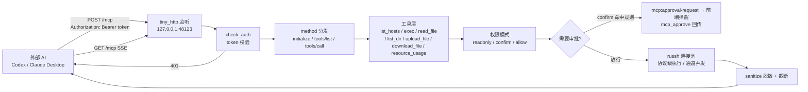
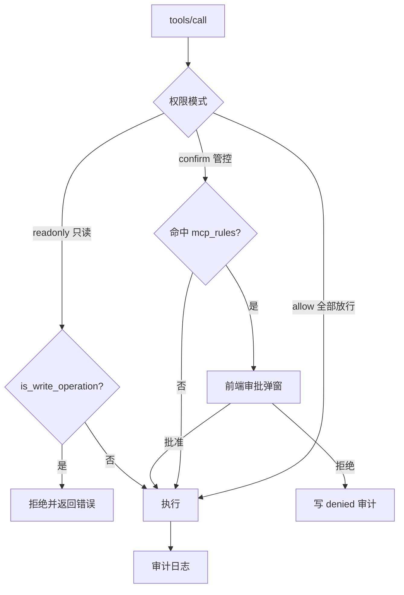

# 对外 MCP 服务设计

> buffTerm 作为 MCP 服务器（自研 Streamable HTTP + JSON-RPC + token 认证），把用户勾选的服务器能力开放给外部 AI（Codex、Claude Desktop 等）。协议层基于 tiny_http 手写实现，无框架依赖。
>
> **2026-10 安全策略更新**：`readonly` 已从“命中危险表才拒绝”改为默认拒绝的安全只读白名单（`is_safe_readonly_command`）；`confirm` 对非安全只读命令、敏感路径与自定义规则都要求审批。下文旧图中的 `is_write_operation` 三层判定为历史实现，以代码为准。

## 1. 架构



- 服务**按需启动**：用户勾选主机并点「启动服务」才监听 `127.0.0.1`（默认端口 48123，被占用则随机），应用启动且配置 `enabled` 时自动恢复监听；
- 首次启用时生成随机 token（64 位 hex），AES-256-GCM 加密存 `credentials` 表，不再落 `mcp_service` 明文；支持吊销重生成（`rotate_mcp_token`），旧版本明文 token 在应用启动时自动迁移；关闭通过 oneshot 通知监听线程退出。

## 2. 鉴权

```rust
fn check_auth(app: &AppHandle, request: &Request) -> bool {
    let db = match app.try_state::<Arc<Db>>() {
        Some(db) => db,
        None => return false,
    };
    // 优先历史 mcp_service 明文字段（迁移兼容），否则读 credentials 中的加密 token
    let token = db.get_mcp_service().ok().and_then(|c| c.token)
        .filter(|t| !t.is_empty())
        .or_else(crate::credentials::get_mcp_token)
        .unwrap_or_default();
    if token.is_empty() { return false; }
    // Authorization 支持裸 token、Bearer / bearer；比较使用 token_eq 常量时间比较。
    // 查询参数 ?access_token=... 会先 percent-decode，再用 token_eq 校验。
    /* ... */
}
```

- 生成新 token / 轮换时立即写入 `credentials` 并刷新内存缓存，鉴权立即生效；
- 旧版 `mcp_service.token` 明文字段仅作迁移兼容，启动迁移成功后即清空；
- CORS 仅回显 localhost / 127.0.0.1 / tauri 协议的 origin，普通本地 MCP 客户端不依赖 CORS。

## 3. 协议与请求分发

- `POST /mcp`：JSON-RPC 2.0，支持 `initialize`（协议版本 `2025-03-26`、`serverInfo.name = buffterm-ssh`）、`notifications/initialized`、`notifications/cancelled`、`ping`、`tools/list`、`tools/call`；
- `GET /mcp`：SSE 事件流（心跳保活）。tiny_http 的 `respond` 会先把响应写入 BufWriter，无限流 body 阻塞读取时 header 无法 flush，因此 SSE 用 `request.into_writer()` 手动写响应头并立即 flush；
- 工具调用同步返回 `{ content: [{ type: "text", text }], isError }`；错误以 `isError: true` 返回，避免中断外部 AI 会话。

```mermaid
flowchart TD
  R[请求] --> M{method?}
  M -->|initialize| I[serverInfo + 协议能力]
  M -->|ping| P[{}]
  M -->|tools/list| L[返回 tools_schema]
  M -->|tools/call| C[call_tool 分发]
  M -->|其他| E[json_error -32601]
  C --> OK[{"content:[text], isError:false"}]
  C --> ERR[{"content:[错误], isError:true"}]
```

```rust
"tools/call" => {
    let name = value["params"]["name"].as_str().unwrap_or("").to_string();
    let args = value["params"]["arguments"].clone();
    let args = if args.is_object() { args } else { serde_json::json!({}) };
    match call_tool(app, &name, &args).await {
        Ok(text) => respond(id, serde_json::json!({
            "content": [{ "type": "text", "text": text }], "isError": false })),
        Err(e) => respond(id, serde_json::json!({
            "content": [{ "type": "text", "text": format!("错误: {e}") }], "isError": true })),
    }
}
```

## 4. 工具集（host 参数化）

| 工具 | 参数 | 说明 |
| --- | --- | --- |
| `list_hosts` | — | 仅返回服务启用时勾选的主机 |
| `resource_usage` | host | 磁盘 / 内存 / 负载 / TOP 进程 |
| `read_file` | host, path | 读文件 |
| `list_dir` | host, path? | 列目录 |
| `upload_file` | host, local_path, remote_path, overwrite? | 将 buffTerm 所在电脑的本地文件通过 SFTP 原子上传到服务器；默认拒绝覆盖，单文件上限 2 GiB，支持 MCP 取消 |
| `download_file` | host, remote_path, local_path, overwrite? | 将服务器远端文件通过 SFTP 原子下载到 buffTerm 所在电脑；默认拒绝覆盖，单文件上限 2 GiB，支持 MCP 取消 |
| `exec_command` | host, command, timeout_secs? | 执行命令（受权限模式约束） |

- `host` 支持 id / name / address 三种匹配，未勾选的主机直接拒绝（“未授权给 MCP 服务”）；
- 外部 AI 不依赖“当前已连接主机”，每次调用按需通过 russh 连接池执行；
- 输出区分 stdout / stderr（stderr 非空时分段展示），复用 `safety::sanitize` 脱敏 + `util::format_exec_output` 截断；复用连接断开时只读命令自动重连重试一次，写命令不自动重试；外部调用同样写审计日志（`permission_mode = mcp`）。

### 文件传输方案

- 当前采用兼容所有 MCP 客户端的 `upload_file(local_path, remote_path, overwrite?)` 与 `download_file(remote_path, local_path, overwrite?)`，文件字节不进入 JSON-RPC 和模型上下文；buffTerm 在本机与远端之间通过现有 SFTP 临时文件 + rename 原子上传/下载。
- `readonly` 拒绝上传和下载；`confirm` 每次弹窗展示路径、文件大小与覆盖状态；`allow` 直接放行。所有结果均写入 MCP 审计。
- `overwrite` 默认 `false`：远端/本地目标已存在时直接拒绝；显式传 `true` 才原子替换。审批摘要会显示 `overwrite=true/false`。
- 单文件上限 2 GiB，预检和传输过程中双重校验；客户端发送 `notifications/cancelled` 会设置传输取消标志，临时文件随即清理。
- 下载使用 canonical 远端路径和已打开句柄的 `fstat`；实际字节少于已知远端大小时判定截断，`flush` / `sync_all` 失败不会替换原文件。
- 上传本地路径必须是绝对文件路径；原始路径、canonical 路径和符号链接真实目标都会检查，`.ssh`、`.aws`、`.gnupg` 等敏感凭据位置始终拒绝。
- 下载本地目标必须是绝对文件路径；父目录会 canonical 后再拼接文件名，敏感凭据目录、目录目标和不存在的父目录均拒绝。远端符号链接解析到敏感路径时直接拒绝，防止远端预置链接外传凭据。
- 上传/下载的远端路径都必须是绝对路径；仅在 `overwrite=true` 时原子替换已有目标，失败或取消不会截断原文件。远端目标会 canonical 并在打开/创建前立即复核；SFTP 无 `O_NOFOLLOW`，canonical 目标自身被替换仍有极小竞态窗口。
- SEP-2356 已关闭，后续官方 `io.modelcontextprotocol/files` 仍是实验草案且要求 2026-07-28；当前服务保持 2025-03-26，不提前引入不兼容的扩展协商。升级协议后再增加 out-of-band 上传目标。

## 5. 权限模式



只读模式写操作检测（`is_write_operation`）三层：

1. 命中内置危险命令表（rm / mkfs / 关机等）→ 视为写操作；
2. 重定向写文件：清理掉 `2>/dev/null`、`2>&1` 等无害写法后仍含 `>` / `>>` → 拒绝；
3. 写类命令关键词：touch / mv / cp / chmod / chown / sed -i / apt / yum / pip install / curl -o / scp / tar -x / git push / docker 等 → 拒绝。

管控模式审批桥接（真实代码）：

```rust
// mcp.rs：危险命令命中 → 注册 oneshot → 发前端事件 → 等待决定
let registry = app.state::<ApprovalRegistry>();
let rx = registry.register(request_id.clone());
app.emit("mcp:approval-request", json!({ "request_id", "host", "command", ... }));
let approved = tokio::time::timeout(Duration::from_secs(600), rx).await?;
```

前端 `McpApprovalModal` 展示主机与命令，用户点「批准 / 拒绝」后调用 `mcp_approve(request_id, allow)`，后端通过 oneshot 放行或终止；拒绝时写 `denied` 审计日志。

## 6. 接入配置

开启后弹窗自动生成并复制：

```json
{
  "mcpServers": {
    "buffterm-ssh": {
      "type": "http",
      "url": "http://127.0.0.1:48123/mcp",
      "headers": { "Authorization": "Bearer <token>" }
    }
  }
}
```
